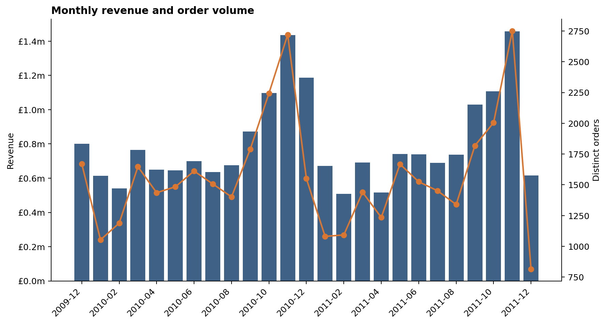
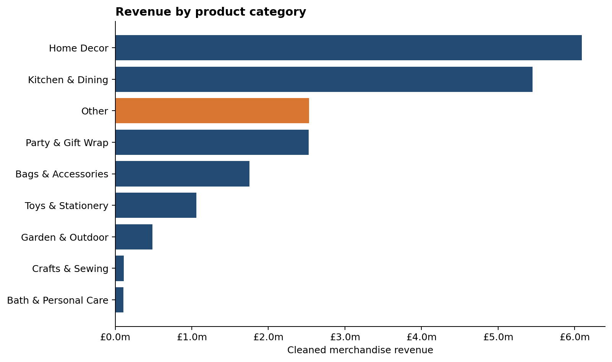
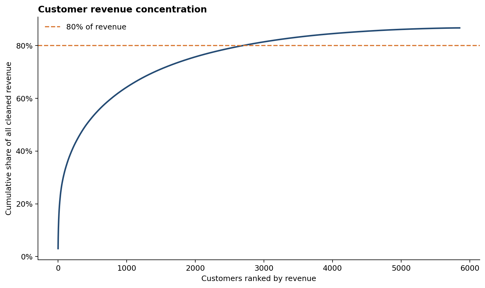

# E-commerce Sales and Customer Behavior Analysis

An end-to-end Python and SQL analysis of 1,036,899 cleaned line items from UCI's Online Retail II dataset. The project turns two years of transaction records into a reproducible SQLite store, three management-facing findings, and independent SQL checks.



## Findings

1. **What drives the product mix?** Home Decor leads with **£6.09 million**, or **30.3%** of cleaned merchandise revenue. The rule-based taxonomy leaves **12.6%** in `Other`, below the 30% review threshold but still a stated limitation.

   

2. **Is revenue concentrated?** The United Kingdom contributes **85.7%** of revenue. Customer concentration is less extreme: the largest identified customer contributes **3.0%**, and the top 10 contribute **13.9%**.

   

3. **When does demand peak?** November 2011 is the strongest month at **£1.46 million** from **2,751 orders**. In February 2010, May 2010, and February 2011, orders increased while revenue did not; that is a discount or product-mix signal, not proof of promotion activity.

The full caveats and exact scope are in [reports/SUMMARY.md](reports/SUMMARY.md).

## Reproduce the analysis

The raw workbook is not committed because it is 43.5 MB. Download `online_retail_II.xlsx` from the [UCI Online Retail II page](https://archive.ics.uci.edu/dataset/502/online+retail+ii) and place it in `data/raw/`.

```bash
python3 -m venv .venv
source .venv/bin/activate
pip install -r requirements.txt
make all
```

`make all` runs the tests, reads both workbook sheets, rebuilds the SQLite database and charts, executes the notebook from top to bottom, and verifies the headline metrics with independent SQL. For a fast plumbing check without the real workbook, run `make smoke`; every output is then labeled `SYNTHETIC` and must not be used as a finding.

## Repository structure

```text
├── README.md
├── DATA_DICTIONARY.md
├── Makefile
├── requirements.txt
├── data/
│   ├── raw/README.md
│   └── processed/                 # generated SQLite database
├── notebooks/01_ecommerce_analysis.ipynb
├── reports/
│   ├── SUMMARY.md
│   └── figures/
├── sql/analysis.sql
├── src/
│   ├── data_loader.py
│   ├── metrics.py
│   ├── plots.py
│   ├── reporting.py
│   ├── run_analysis.py
│   ├── sql_check.py
│   └── storage.py
└── tests/
```

## Analytical choices

- Gross merchandise revenue is `Quantity × UnitPrice` after cancellations, returns, invalid rows, postage, fees, and other non-merchandise lines are removed.
- Rows with missing customer IDs remain in revenue and order totals but are excluded from customer concentration calculations.
- Product categories are transparent keyword rules over descriptions, not an official hierarchy. See [DATA_DICTIONARY.md](DATA_DICTIONARY.md) for the rules and limitations.
- December 2011 is a partial month in the source, so it is shown but not compared as if it were a full holiday month.

Dataset citation: Chen, D. (2012). *Online Retail II*. UCI Machine Learning Repository. https://doi.org/10.24432/C5CG6D
